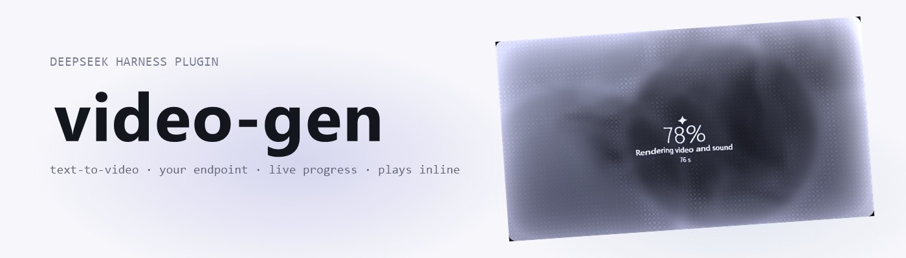
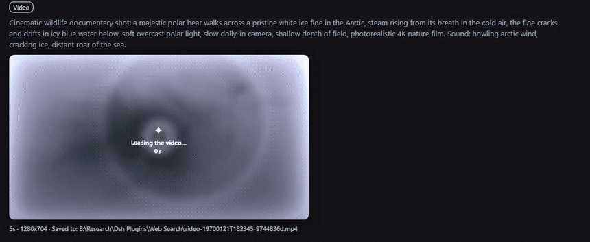
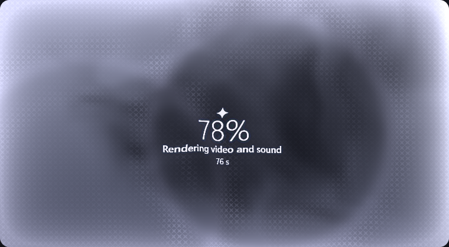

<picture>
  <source media="(prefers-color-scheme: dark)" srcset="assets/banner-dark.png">
  
</picture>

<br>

# dsh-video-gen

English | [中文](README.zh.md)

Video generation for [DeepSeek Harness](https://github.com/deepseek-ai/deepseek-harness): text-to-video, image-to-video from a start frame, a clip that plays in the conversation, live progress, and cancel — against **your own** OpenAI-style asynchronous video API. No vendor is baked in; you add endpoints in Settings.

     

## What it does

| Surface | Behaviour |
| --- | --- |
| `generate_video` | Queues a clip. `prompt` is required; `seconds`, `size`, `orientation`, `fps`, `seed`, `enhance`, `negative_prompt` and `model` are optional. |
| Start frame | Pass `image_url`, `source_attachment_id` (an image already in the chat), or `source_path` (a file in the session workspace). That picture becomes the clip's **first frame**. |
| `check_video` | One job by id, or the recent list. Also adopts a job id this host never saw by asking the server. |
| `cancel_video` | Stops a queued or running render so the GPU frees up. |
| Tool card | The finished MP4 plays inline with native controls and seeks via `Range` requests; while rendering, the card shows a "being made" sheet — ripples, plain-words stage, percent, and time — with a cancel button, and ripples the first frame in when the clip is ready. |





Long renders do not hold the conversation: `generate_video` waits for `waitGraceMs` (default 2 minutes) and then returns the job id. Use `wait: "until_done"` to block for the whole render, or `wait: "none"` to return immediately.

The plugin ships with **no endpoint configured**. That is deliberate: it is published for anyone, so the first thing you see is the settings card, not a request to a host you never chose.

## Requirements

- DeepSeek Harness 0.1.7-rc.2 or newer (`@deepseek-ai/dsh-*` peer generation 0.1.7).
- One video API that speaks the OpenAI-style asynchronous shape (see below), plus its API key.
- A web profile: the clip card, the progress poll, and the settings card use the harness web server.

## Install

> **The npm name is taken.** `dsh-video-gen` on the registry is a *different* plugin (Yang-wudi's DashScope/Veo/Sora tool), so `dsh plugin add dsh-video-gen` installs that one, not this. This repo ships its own build as a release tarball; install it by URL or by path.

**From the latest release** — the tarball is attached to every release as `plugin.tgz`:

```powershell
cd C:\Users\<you>\.dsh\profiles\web
pnpm add https://github.com/adithyanraj03/dsh-video-gen/releases/latest/download/plugin.tgz
```

Then add the name to `dsh.profile.bundles` in that profile's `package.json` and restart the host:

```json
"dsh": { "profile": { "bundles": ["dsh-video-gen"] } }
```

**From a local checkout** (what this repo's own development uses):

```powershell
pnpm install
pnpm run build
```

Then link it into a profile and add it to that profile's bundles:

```powershell
# C:\Users\<you>\.dsh\profiles\web\package.json
#   "dependencies": { "dsh-video-gen": "link:B:/Research/dsh-video-gen" }
#   "dsh": { "profile": { "bundles": ["dsh-video-gen", ...] } }
pnpm install --dir C:\Users\<you>\.dsh\profiles\web
```

**In the desktop app** — Settings → **Plugins** → **Add plugin**, then paste the repository address (`https://github.com/adithyanraj03/dsh-video-gen`). Installed plugins do not update themselves yet: uninstall and install again to upgrade.

A profile must load exactly one copy. Installing the tarball while the link row is still there boots the plugin twice.

## Configure: add an endpoint

Open **Settings → Plugins → Video generation** (the card also appears on this plugin's own page in the plugin manager). Then:

1. **Add endpoint** and give it a name.
2. **Base URL** — the API root including its version prefix, for example `https://your-host/v1`.
3. **API key** — paste the bearer token and press **Save key**. The token goes to the harness credential store under the name in the *Credential name* field (`VIDEO_GEN_KEY_<ENDPOINT>` by default); it never enters the settings JSON, the page state after saving, or any log. Point *Credential name* at a credential you already store (for example `MY_VIDEO_KEY`) to reuse it.
4. **Test & fetch models** — the host calls `GET /models` on that endpoint with the key and puts the ids in the model picker. If your server does not expose `/models`, type the model id by hand; the probe then says so instead of failing silently.
5. **Save settings**. The endpoint marked *use this endpoint* is the one tool calls use.

Every field is per endpoint, and the endpoint can override the global defaults (seconds, size, fps, orientation, prompt enhancer).

### Settings reference

| Option | Default | Meaning |
| --- | --- | --- |
| `connections` | `[]` | Endpoint rows: id, label, base URL, model, credential name, per-endpoint defaults. |
| `activeConnection` | empty | Endpoint tool calls use; empty means the first row. |
| `defaultSeconds` / `defaultSize` / `defaultFps` | `5` / `720p` / `24` | Used when the call omits them. |
| `defaultEnhance` | `false` | Server-side prompt enhancer before rendering (adds 1–2 minutes). |
| `waitGraceMs` | `120000` | How long `generate_video` holds the turn. |
| `jobTimeoutMs` | `3600000` | Overall budget per job before it is abandoned. |
| `saveToWorkspace` / `workspaceFolder` | `true` / `videos` | Also copy finished clips into the session workspace. |
| `videosDir` | empty | Clip directory override; empty keeps `~/.dsh/plugins/video-gen/videos`. |
| `toolNameSet` | `generic` | `generic` registers `generate_video` / `check_video` / `cancel_video`; `prefixed` registers `videogen_generate_video` / `videogen_check_video` / `videogen_cancel_video`. |

`toolNameSet` exists because tool names are global across plugins. The default verbs deliberately avoid `video_generate`, which `dsh-plugin-subscriptions` already registers for its Grok video tool — with both installed, claiming that name aborts the boot. If another plugin ever owns one of these names, the boot fails with `tool "<name>" is already registered`; switching `toolNameSet` to `prefixed` and restarting fixes that without uninstalling anything.

A config-only setup also works without the card: set `baseUrl`, `model`, and `apiKeyRef` in the plugin's `cordis.patch.yml` row. The card then shows that endpoint as *Configured endpoint* and can still take over.

## The API shape it expects

One endpoint per row, all calls bearer-authenticated:

| Call | Purpose |
| --- | --- |
| `POST /videos` | Submit. JSON body, or multipart with the start frame in `input_reference` (PNG/JPEG/WebP, one image, ≤ 20 MB). |
| `GET /videos/{id}` | Poll: `status` (`queued`, `in_progress`, `completed`, `failed`, others are tolerated), `progress`, `stage`, `queue_position`, `error.code`. |
| `GET /videos/{id}/content` | MP4 bytes; `?variant=thumbnail` for the middle-frame JPEG. |
| `DELETE /videos/{id}` | Cancel. |
| `GET /models` | Model ids for the settings probe. |

Fields sent on submit: `model`, `prompt`, `seconds` (as a string), `size` (`WxH`), `orientation`, `fps`, `seed`, `enhance`, `negative_prompt`, `input_reference`.

## How a job runs

1. Submit; the id comes back with `status: queued`.
2. The store polls every 3 s, backing off up to 30 s while the network or the server misbehaves. Polling survives a host restart: unfinished jobs are re-attached on boot.
3. On completion the MP4 is streamed (bounded by `maxVideoBytes`), written atomically, and the thumbnail is fetched.
4. A finished clip is copied into the session workspace exactly once; job history is kept in `jobs.json` next to the clips (last 50 by default).

## Browser routes

Served same-origin by the plugin, gated by the harness connection trust decision:

| Route | Purpose |
| --- | --- |
| `/plugins/dsh-video-gen/video?job=<id>` | MP4 stream, `Range`/`ETag`/`304` aware. |
| `/plugins/dsh-video-gen/thumb?job=<id>` | Stored middle-frame JPEG (poster). |
| `/plugins/dsh-video-gen/jobs` | Recent job state the tool card polls while rendering. |
| `/plugins/dsh-video-gen/cancel` | `POST { id }` to stop a job. |
| `/plugins/dsh-video-gen/models` | `POST { baseUrl, apiKeyRef, keyValue? }` — probe one endpoint and list its models. |
| `/plugins/dsh-video-gen/credential` | `GET ?ref=NAME` describes a key; `POST { ref, value }` stores it (blank removes). |
| `/plugins/dsh-video-gen/test` | `POST` probe of the active endpoint. |
| `/plugins/dsh-video-gen/settings-health` | Which settings generation the host serves. |

## Development

```powershell
pnpm run typecheck   # tsc --noEmit
pnpm run build       # clean lib/, ts scoped to lib/types, tsdown host + client bundles
pnpm run test        # vitest: 146 cases
pnpm run test:package
pnpm run pack:check
```

Layout: `src/*.ts` is the host fiber (`index.ts` registers the tools and routes), `src/client/` is the browser bundle (the settings card, the tool result card, and the `dsh-video-result` conversation node), `tests/` covers the pure parts and the HTTP surfaces. `lib/index.js` and `lib/client.js` are build outputs and are not committed. The icon is artwork from the image-gen tool, framed and masked by the `make_icon` pipeline into `assets/icon.png` (a deterministic fallback exists in `scripts/make-icon.py`).

## Limits and known behaviour

- Clips are 1–30 s, fps 8–50, one start frame per job, PNG/JPEG/WebP ≤ 20 MB. GIF is refused.
- Sizes snap to a 64-pixel lattice inside 1920×1088; a tier name picks the box, `WxH` is honoured, and `orientation` flips it.
- A start frame without an explicit `size` picks the box orientation from the picture's aspect ratio.
- `image_url` is fetched by the host, so an authenticated or local-only URL will not work — use `source_attachment_id` or `source_path` instead.
- Without a web profile the tools still run, but no card, no progress, and no settings form.
- A restarted server forgets job *ids* it was tracking only if the history file was lost; clip files stay addressable anyway, because a job id's last eight hex characters name its file.
- The desktop app and `dsh web` can both load this plugin and share one clip directory. Each keeps its own `jobs.json`, so they used to overwrite each other's history; the history is now written merge-safe, and the clip routes find a file by its job-id suffix when a record is missing. Point `videosDir` at a separate folder per host when you run both anyway.

## Compatibility

| dsh-video-gen | DeepSeek Harness | Notes |
| --- | --- | --- |
| 0.2.2 | 0.1.7-rc.2 | The card stops assuming one vendor's engine: the stage matcher reads any engine name, so a server this plugin has never seen still resolves "Starting the video engine", "Loading the models", "Generating the frames". The README gains the banner, the badge row and a GIF of the reveal. |
| 0.2.1 | 0.1.7-rc.2 | The sheet now also renders during the `generate_video` wait grace, tracking the real job through the host's own selection rule (prompt match, else a single active job), so percent and stage move instead of freezing at 0%; the water/ripples/words actually draw, the words follow every poll (they live in the sheet texture), and a progress log under the sheet keeps one line per distinct engine answer; a settled generate result is promoted to a session-located chat row (kind `dsh-video-result`) that appears while the turn is still running and survives Tool-process folding; clip history is written merge-safe and the clip routes fall back to the job id's file suffix, so a restart or a second host sharing the folder no longer leaves old clips unplayable. |
| 0.2.0 | 0.1.7-rc.2 | The "being made" sheet, first-frame reveal, and cancel button in the render card; `check_video` with one job shows the same card; `createdAt` (epoch ms) on the tool output. |
| 0.1.0 | 0.1.7-rc.2 | Settings card renders on `plugins.bundle.config`; the legacy `settings.plugin.item` seat is kept for hosts at or below 0.1.5. Schema uses the 0.1.7 volatile form with the `installSection` relay as fallback. |

## License

Apache-2.0. See [LICENSE](LICENSE).
