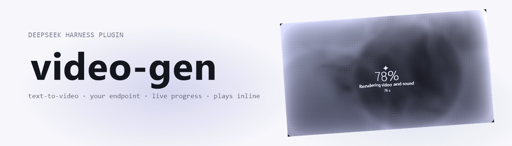
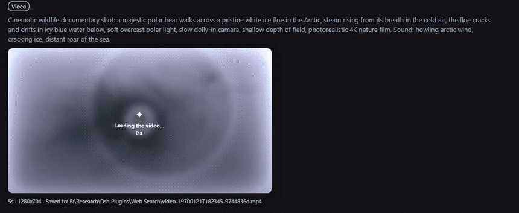
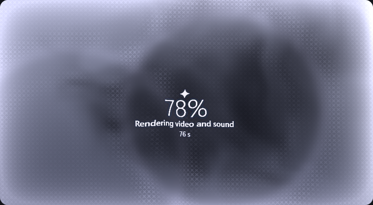

<picture>
  <source media="(prefers-color-scheme: dark)" srcset="assets/banner-dark.png">
  
</picture>

<br>

# dsh-video-gen

[English](README.md) | 中文

     

给 [DeepSeek Harness](https://github.com/deepseek-ai/deepseek-harness) 的视频生成插件：文生视频、以一张图作为起始帧的图生视频、在对话里直接播放的片段、实时进度，以及取消——对着**你自己的** OpenAI 风格异步视频 API。不绑定任何厂商；端点在设置里添加。

## 功能

| 入口 | 行为 |
| --- | --- |
| `generate_video` | 提交一个片段。`prompt` 必填；`seconds`、`size`、`orientation`、`fps`、`seed`、`enhance`、`negative_prompt` 与 `model` 可选。 |
| 起始帧 | 传 `image_url`、`source_attachment_id`（对话里已有的图片）或 `source_path`（会话工作区里的文件），这张图就成为片段的**第一帧**。 |
| `check_video` | 按 id 查一个任务，或列出最近的任务。本机没见过的 job id 也会向服务器问一次并接管。 |
| `cancel_video` | 停掉排队中或正在渲染的任务，把 GPU 让出来。 |
| 工具卡片 | 渲染完成后 MP4 直接内嵌播放，原生控件通过 `Range` 请求拖动；渲染过程中卡片显示「制作中」的幕布——涟漪、口语化的阶段名、百分比与耗时——旁边带取消按钮，片段就绪时第一帧以涟漪方式浮现。 |





长时间渲染不会占住对话：`generate_video` 等到 `waitGraceMs`（默认 2 分钟）后返回 job id。想阻塞到整段渲染完成用 `wait: "until_done"`，想立即返回用 `wait: "none"`。

插件出厂**不带任何端点**。这是有意的：它是给所有人用的，所以你第一眼看到的是设置卡片，而不是一个你没选过的服务器的请求。

## 要求

- DeepSeek Harness 0.1.7-rc.2 或更新（`@deepseek-ai/dsh-*` 0.1.7 一代）。
- 一个说 OpenAI 风格异步接口（见下）的视频 API，以及它的 API key。
- 一个 web profile：卡片、进度轮询与设置卡片都走 harness 的 web server。

## 安装

> **包名是 `dsh-video-gen-plugin`。** npm 上这个名字还没人占，但目前尚未发布——本仓库把自己的构建产物作为 release 附件发布，所以按 URL 或路径安装。不要用 `dsh plugin add dsh-video-gen`：注册表上的那个包是另一个插件（Yang-wudi 的 DashScope/Veo/Sora 工具）。

**从最新 release 安装**——每个 release 都附带名为 `plugin.tgz` 的 tarball：

```powershell
cd C:\Users\<you>\.dsh\profiles\web
pnpm add https://github.com/adithyanraj03/dsh-video-gen-plugin/releases/latest/download/plugin.tgz
```

然后在该 profile 的 `package.json` 里把名字加进 `dsh.profile.bundles`，重启宿主：

```json
"dsh": { "profile": { "bundles": ["dsh-video-gen-plugin"] } }
```

**从本地检出安装**（本仓库自己的开发方式）：

```powershell
pnpm install
pnpm run build
```

再把它链接进 profile 并加入 bundles：

```powershell
# C:\Users\<you>\.dsh\profiles\web\package.json
#   "dependencies": { "dsh-video-gen-plugin": "link:B:/Research/dsh-video-gen" }
#   "dsh": { "profile": { "bundles": ["dsh-video-gen-plugin", ...] } }
pnpm install --dir C:\Users\<you>\.dsh\profiles\web
```

**在桌面版里**——设置 → **插件** → **添加插件**，粘贴仓库地址（`https://github.com/adithyanraj03/dsh-video-gen-plugin`）。目前已安装的插件不会自动更新：升级要卸载后再装一次。

一个 profile 只能加载一份。tarball 装好的同时链接行还在，插件会被启动两次。

## 配置：添加端点

打开 **设置 → 插件 → 视频生成**（插件管理页里这个插件自己的页面也有同一张卡片）。然后：

1. **添加端点**，给它起个名字。
2. **Base URL**——API 根地址，含版本前缀，例如 `https://your-host/v1`。
3. **API key**——粘贴 bearer token 后按 **保存密钥**。token 以 *凭证名* 字段里的名字（默认 `VIDEO_GEN_KEY_<ENDPOINT>`）存进 harness 的凭证库；它不会进设置 JSON、不会留在保存后的页面状态里，也不会出现在任何日志中。把 *凭证名* 指向一个你已经存好的凭证（例如 `MY_VIDEO_KEY`）即可复用。
4. **测试并获取模型**——宿主用该密钥调用这个端点的 `GET /models`，把 id 填进模型选择器。服务器没有 `/models` 时手写模型 id 也行；探针会明说，而不是静默失败。
5. **保存设置**。被标为*使用此端点*的那一行，就是工具调用会用的端点。

每个字段都是按端点存的，端点还可以覆盖全局默认值（时长、尺寸、帧率、方向、提示词增强）。

### 设置项

| 选项 | 默认 | 含义 |
| --- | --- | --- |
| `connections` | `[]` | 端点行：id、显示名、base URL、模型、凭证名、按端点的默认值。 |
| `activeConnection` | 空 | 工具调用使用的端点；空表示第一行。 |
| `defaultSeconds` / `defaultSize` / `defaultFps` | `5` / `720p` / `24` | 调用未指定时使用。 |
| `defaultEnhance` | `false` | 渲染前的服务端提示词增强（会多 1–2 分钟）。 |
| `waitGraceMs` | `120000` | `generate_video` 占用这一轮的时长。 |
| `jobTimeoutMs` | `3600000` | 单个任务的总预算，超过即放弃。 |
| `saveToWorkspace` / `workspaceFolder` | `true` / `videos` | 是否把成片也复制进会话工作区。 |
| `videosDir` | 空 | 片段目录覆盖；空则用 `~/.dsh/plugins/video-gen/videos`。 |
| `toolNameSet` | `generic` | `generic` 注册 `generate_video` / `check_video` / `cancel_video`；`prefixed` 注册 `videogen_generate_video` / `videogen_check_video` / `videogen_cancel_video`。 |

`toolNameSet` 存在是因为工具名在插件之间是全局的。默认动词刻意避开 `video_generate`——`dsh-plugin-subscriptions` 已经用这个名字注册了它的 Grok 视频工具，两个都装时抢占该名字会让启动中断。若别的插件占了这里某个名字，启动会报 `tool "<name>" is already registered`；把 `toolNameSet` 切到 `prefixed` 再重启即可，不用卸载任何东西。

只用配置、不用卡片也可以：在插件的 `cordis.patch.yml` 行里设置 `baseUrl`、`model` 与 `apiKeyRef`。卡片会把该端点显示为*已配置端点*，仍可接手管理。

## 它期望的 API 形态

一行一个端点，所有调用都带 bearer 认证：

| 调用 | 用途 |
| --- | --- |
| `POST /videos` | 提交。JSON body，或用 multipart 把起始帧放在 `input_reference`（PNG/JPEG/WebP，一张，≤ 20 MB）。 |
| `GET /videos/{id}` | 轮询：`status`（`queued`、`in_progress`、`completed`、`failed`，其他值也容忍）、`progress`、`stage`、`queue_position`、`error.code`。 |
| `GET /videos/{id}/content` | MP4 字节；`?variant=thumbnail` 取中间帧 JPEG。 |
| `DELETE /videos/{id}` | 取消。 |
| `GET /models` | 供设置页探针使用的模型 id。 |

提交时发送的字段：`model`、`prompt`、`seconds`（字符串）、`size`（`WxH`）、`orientation`、`fps`、`seed`、`enhance`、`negative_prompt`、`input_reference`。

## 一个任务怎么跑

1. 提交；返回的 id 带 `status: queued`。
2. 任务表每 3 秒轮询一次，网络或服务器异常时退避到最多 30 秒。轮询能熬过宿主重启：重启时未完成的任务会被重新接上。
3. 完成后 MP4 以流式下载（受 `maxVideoBytes` 限制），原子写入，并抓取缩略图。
4. 成片只往会话工作区复制一次；任务历史存在片段旁边的 `jobs.json`（默认保留最近 50 条）。

## 浏览器路由

由插件同源提供，先过 harness 的连接信任判定：

| 路由 | 用途 |
| --- | --- |
| `/plugins/dsh-video-gen-plugin/video?job=<id>` | MP4 流，支持 `Range`/`ETag`/`304`。 |
| `/plugins/dsh-video-gen-plugin/thumb?job=<id>` | 存下的中间帧 JPEG（封面）。 |
| `/plugins/dsh-video-gen-plugin/jobs` | 渲染过程中工具卡片轮询的近期任务状态。 |
| `/plugins/dsh-video-gen-plugin/cancel` | `POST { id }` 停止任务。 |
| `/plugins/dsh-video-gen-plugin/models` | `POST { baseUrl, apiKeyRef, keyValue? }`——探测一个端点并列出它的模型。 |
| `/plugins/dsh-video-gen-plugin/credential` | `GET ?ref=NAME` 描述一个密钥；`POST { ref, value }` 保存（空值即删除）。 |
| `/plugins/dsh-video-gen-plugin/test` | `POST` 探测当前端点。 |
| `/plugins/dsh-video-gen-plugin/settings-health` | 宿主提供的是哪一代设置能力。 |

## 开发

```powershell
pnpm run typecheck   # tsc --noEmit
pnpm run build       # clean lib/, ts scoped to lib/types, tsdown host + client bundles
pnpm run test        # vitest: 146 cases
pnpm run test:package
pnpm run pack:check
```

结构：`src/*.ts` 是宿主侧（`index.ts` 注册工具与路由），`src/client/` 是浏览器侧（设置卡片、工具结果卡片、`dsh-video-result` 对话节点），`tests/` 覆盖纯逻辑与 HTTP 面。`lib/index.js` 与 `lib/client.js` 是构建产物，不入库。图标由 image-gen 出图、经 `make_icon` 裁成 `assets/icon.png`（`scripts/make-icon.py` 里有确定性兜底）。

## 限制与已知行为

- 片段 1–30 秒、帧率 8–50、每个任务一张起始帧、PNG/JPEG/WebP ≤ 20 MB。GIF 会拒绝。
- 尺寸吸附到 1920×1088 以内 64 像素的格点；给档位名按档位取框，给 `WxH` 按原样，`orientation` 负责翻转。
- 起始帧没给 `size` 时，按图片宽高比决定框的方向。
- `image_url` 由宿主抓取，所以需要认证或只在本机可达的 URL 不行——改用 `source_attachment_id` 或 `source_path`。
- 没有 web profile 时工具照常能跑，但没有卡片、没有进度、没有设置表单。
- 服务器重启后，只有历史文件丢了才会忘掉它正在跟踪的 job *id*；片段文件本身依然可按 job id 的末八位十六进制字符找到。
- 桌面版与 `dsh web` 可以同时加载本插件并共用同一个片段目录。各自维护自己的 `jobs.json`，以前会互相覆盖历史；现在历史是合并写入的，记录缺失时路由也会按 job id 后缀去找文件。两个都跑时，还是建议给 `videosDir` 各指一个目录。

## 兼容性

| dsh-video-gen | DeepSeek Harness | 说明 |
| --- | --- | --- |
| 0.2.2 | 0.1.7-rc.2 | 卡片不再假定某个厂商的引擎：阶段匹配读取任意引擎名，所以这台插件没见过的服务器也能解析出「Starting the video engine」「Loading the models」「Generating the frames」。README 增加了 banner、徽章行与揭示动画 GIF。 |
| 0.2.1 | 0.1.7-rc.2 | 幕布现在也覆盖 `generate_video` 的等待宽限期，并按宿主自己的选择规则（先按提示词匹配，否则取唯一的活跃任务）跟踪真实任务，百分比与阶段会动而不是冻在 0%；水波、涟漪与文字真正画出来，文字随每次轮询重绘（它们存在于幕布纹理里），幕布下方还留有一行行的阶段日志；已结束的生成结果会被提升为会话级的对话行（kind `dsh-video-result`），在轮次进行中就会出现，工具过程折叠后依然可见；片段历史改为合并写入，记录缺失时路由按 job id 的文件后缀兜底，重启或第二台宿主共用目录都不再让旧片段播不了。 |
| 0.2.0 | 0.1.7-rc.2 | 渲染卡片里的「制作中」幕布、首帧揭示与取消按钮；`check_video` 查单个任务时显示同一张卡片；工具输出带 `createdAt`（epoch 毫秒）。 |
| 0.1.0 | 0.1.7-rc.2 | 设置卡片挂在 `plugins.bundle.config`；0.1.5 及更早的宿主保留旧的 `settings.plugin.item` 席位。Schema 用 0.1.7 的 volatile 形式，并以 `installSection` 中继作为兜底。 |

## 许可证

Apache-2.0，见 [LICENSE](LICENSE)。
