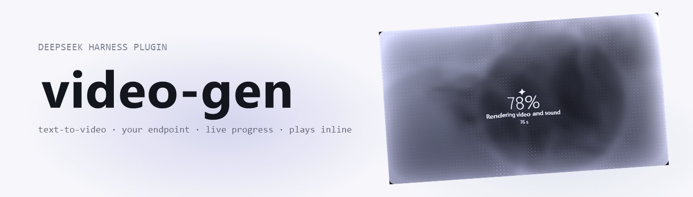
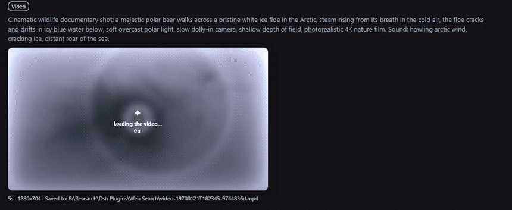

<picture>
  <source media="(prefers-color-scheme: dark)" srcset="assets/banner-dark.png">
  
</picture>

# dsh-video-gen

Video generation for [DeepSeek Harness](https://github.com/deepseek-ai/deepseek-harness): text-to-video, image-to-video from a start frame, a clip that plays in the conversation, live progress, and cancel — against **your own** OpenAI-style asynchronous video API. No vendor is baked in; you add endpoints in Settings.

[View on GitHub](https://github.com/adithyanraj03/dsh-video-gen){: .btn }

     

---

## What it does

| Surface | Behaviour |
| --- | --- |
| `generate_video` | Queues a clip. `prompt` is required; `seconds`, `size`, `orientation`, `fps`, `seed`, `enhance`, `negative_prompt` and `model` are optional. |
| Start frame | Pass `image_url`, `source_attachment_id` (an image already in the chat), or `source_path` (a file in the session workspace). That picture becomes the clip's first frame. |
| `check_video` | One job by id, or the recent list. Adopts a job id this host never saw by asking the server. |
| `cancel_video` | Stops a queued or running render so the GPU frees up. |
| Tool card | The finished MP4 plays inline with native controls and seeks via `Range` requests; while rendering, the card shows a "being made" sheet — ripples, plain-words stage, percent, and time — with a cancel button. |

Long renders do not hold the conversation: `generate_video` waits for `waitGraceMs` (default 2 minutes) and then returns the job id. Use `wait: "until_done"` to block for the whole render, or `wait: "none"` to return immediately.

The plugin ships with **no endpoint configured**. The first thing you see is the settings card, not a request to a host you never chose.



---

## Install

Install by tarball, not by name: `dsh-video-gen` on the npm registry is a *different* plugin.

```powershell
cd C:\Users\<you>\.dsh\profiles\web
pnpm add https://github.com/adithyanraj03/dsh-video-gen/releases/latest/download/plugin.tgz
```

Then add the name to `dsh.profile.bundles` in that profile's `package.json` and restart the host:

```json
"dsh": { "profile": { "bundles": ["dsh-video-gen"] } }
```

From a local checkout instead:

```powershell
pnpm install
pnpm run build
# link it into the profile's dependencies and add "dsh-video-gen" to its bundles
pnpm install --dir C:\Users\<you>\.dsh\profiles\web
```

In the desktop app: Settings → **Plugins** → **Add plugin**, paste `https://github.com/adithyanraj03/dsh-video-gen`.

---

## Configure an endpoint

Open **Settings → Plugins → Video generation**:

1. **Add endpoint** and give it a name.
2. **Base URL** — the API root including its version prefix, for example `https://your-host/v1`.
3. **API key** — paste the bearer token and press **Save key**; it goes to the harness credential store, never into settings JSON or a log.
4. **Test & fetch models** — the host calls `GET /models` and fills the model picker. If your server has no `/models`, type the id by hand.
5. **Save settings**, then mark that endpoint as *use this endpoint*.

Every field is per endpoint, and an endpoint can override the global defaults (seconds, size, fps, orientation, prompt enhancer).

---

## The API shape it expects

One endpoint per row, all calls bearer-authenticated:

| Call | Purpose |
| --- | --- |
| `POST /videos` | Submit. JSON body, or multipart with the start frame in `input_reference` (PNG/JPEG/WebP, one image, ≤ 20 MB). |
| `GET /videos/{id}` | Poll: `status` (`queued`, `in_progress`, `completed`, `failed`), `progress`, `stage`, `queue_position`, `error.code`. |
| `GET /videos/{id}/content` | MP4 bytes; `?variant=thumbnail` for the middle-frame JPEG. |
| `DELETE /videos/{id}` | Cancel. |
| `GET /models` | Model ids for the settings probe. |

---

## Requirements

- DeepSeek Harness 0.1.7-rc.2 or newer.
- One video API that speaks the shape above, plus its API key.
- A web profile: the clip card, the progress poll, and the settings card use the harness web server.

Apache-2.0. Full documentation, development notes and the release history live in the [repository](https://github.com/adithyanraj03/dsh-video-gen).
